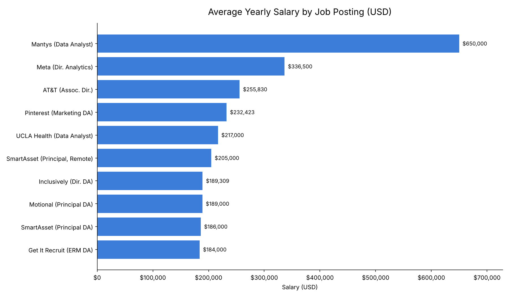
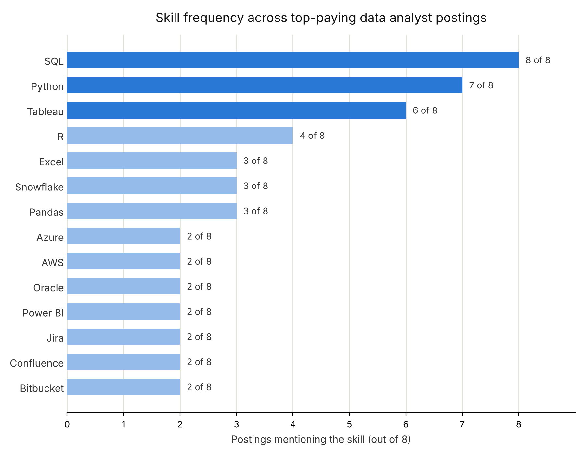

# Introduction
A dive into the Data Analyst job market. Focusing on top paying jobs, high demand skills, and where high demand meets high salary. 

SQL Queries: [project_sql folder](/project_sql/)

# Background
Project to pinpoint top-paid and in-demand skills, streamlining a method to find the optimal job.

Data Source: [SQL Course](https://drive.google.com/drive/folders/1egWenKd_r3LRpdCf4SsqTeFZ1ZdY3DNx?usp=share_link)
Includes job titles, salaries, locations, and essential skills. 

### Questions to Answer
1. What are the top-paying jobs for my role?
2. What are the skills required for these top-paying roles?
3. What are the most in-demand skills for my role?
4. What are the top skills based on salary for my role?
5. What are the most optimal skills (High Demand and High Paying) to learn?

# Tools I Used
- **SQL**: Fundamental to my analysis, allowing me to query the database and unearth crtical insights.
- **PostgreSQL**: The chosen database management system., ideal for handling the job posting data. 
- **Visual Studio Code**: For database management and executing SQL queries. 
- **Git & GitHub**: Essential for version control and sharing my SQL scripts and analysis, enabling collaboration and project tracking. 

# The Analysis
Each query for this project aimed at investigating specific aspects of the Data Analyst job market. 
Here's how I approached each question:

### 1. What are the top-paying jobs for my role?
To identify the highest paying roles, I filtered data analyst positions by average yearly salary and location, focusing on remote jobs. This query highlights the high paying opportunites in the field.

```sql
SELECT
    job_id,
    job_title,
    job_location,
    job_schedule_type,
    salary_year_avg,
    job_posted_date,
    name AS company_name
FROM 
    job_postings_fact
LEFT JOIN
    company_dim ON job_postings_fact.company_id = company_dim.company_id
WHERE
    job_title_short = 'Data Analyst'
    AND
    job_location    = 'Anywhere'
    AND
    salary_year_avg IS NOT NULL
ORDER BY
    salary_year_avg DESC
LIMIT 10;
```
- **Pay Range:** $184K to $650K, but the $650K Mantys listing is likely an outlier. Without it, the average is about $227K.
- **Seniority pays most:** Director roles (Meta at $336.5K) top the list, while Principal-level roles reliably land at $186K to $205K.
- **Not just Big Tech:** Healthcare, Telecom and FinTech all pay $185K to $255K.
- **Domain expertise helps:** Marketing, Risk and AV Analytics roles earn premiums.



### 2. What are the skills required for these top-paying roles?

To understand what skills are required for the top-paying jobs, I joined the jobs postings with the skills data, providing insights into what emplloyers value for high compensation roles. 

```sql
WITH top_paying_jobs AS(
    SELECT
        job_id,
        job_title,
        salary_year_avg,
        name AS company_name
    FROM 
        job_postings_fact
    LEFT JOIN
        company_dim ON job_postings_fact.company_id = company_dim.company_id
    WHERE
        job_title_short = 'Data Analyst'
        AND
        job_location    = 'Anywhere'
        AND
        salary_year_avg IS NOT NULL
    ORDER BY
        salary_year_avg DESC
    LIMIT 10
    )

SELECT 
    top_paying_jobs.*,
    skills
FROM 
    top_paying_jobs
INNER JOIN 
    skills_job_dim ON top_paying_jobs.job_id  = skills_job_dim.job_id
INNER JOIN 
    skills_dim     ON skills_job_dim.skill_id = skills_dim.skill_id
ORDER BY
    salary_year_avg DESC;
```

**SQL, Python and Tableau are the core stack.** SQL appears in all 8 postings, Python in 7 and Tableau in 6. If you only learn three tools, learn these. Tableau is also far more common than Power BI, which appears in only 2.

**Cloud and data warehouse skills are the next step up.** Snowflake appears in 3 postings, and Azure, AWS and Oracle in 2 each. Only the AT&T role, the highest paid at $256K, asks for a full big-data stack (Databricks, PySpark and two clouds). For most of the others, one warehouse plus basic cloud familiarity is enough.

**Seniority drives pay more than the number of skills.** Associate Director, Director and Principal titles fill the list. The top role lists 13 skills and the lowest-paid lists 3, but UCLA Health pays $217K for just 5. A longer skill list doesn't guarantee a higher salary.

**Engineering-style tools show up at senior levels.** Jira, Confluence, Bitbucket, Git and GitLab appear in about a quarter of the postings. Senior analyst roles seem to expect version control and team workflow knowledge alongside analysis, and Excel still appears even at principal level.



### 3. What are the most in-demand skills for my role?
This query helped to identify the skills most frequently requested in job postings, directing focus to areas with high demand.

```sql
SELECT
    skills,
    COUNT(skills_job_dim.job_id) AS demand_count
FROM 
    job_postings_fact
INNER JOIN 
    skills_job_dim ON job_postings_fact.job_id = skills_job_dim.job_id
INNER JOIN 
    skills_dim     ON skills_job_dim.skill_id  = skills_dim.skill_id
WHERE
    job_title_short = 'Data Analyst'
GROUP BY
    skills
ORDER BY
    demand_count DESC
LIMIT 5
```

 **SQL is the clear foundation.** At ~92.6k postings, it leads Excel by roughly 38% and Python by about 62%, so it's the one skill that's close to non-negotiable. Employers still expect analysts to pull and shape their own data rather than wait on engineers.

With ~67k postings, **Excel remains the second most requested skill**, ahead of Python. Spreadsheet fluency is still the everyday language of business stakeholders, so it's a strong signal that many roles are business-facing rather than purely technical.

**Tableau** (~46.6k) and **Power BI** (~39.5k) together total about 86k mentions, nearly matching SQL, which shows that communicating insights matters as much as querying data. Power BI trails Tableau slightly, but the two are largely interchangeable, so learning one well and being familiar with the other is a sensible approach.

| Skill | Demand Count |
| :--- | :--- |
| SQL | 92,628 |
| Excel | 67,031 |
| Python | 57,326 |
| Tableau | 46,554 |
| Power BI | 39,468 |

### 4. What are the top skills based on salary for my role?
Exploring the average salaries associated with the different skills revealed which skills are the highest paying.

```sql
SELECT
    skills,
    ROUND(AVG(salary_year_avg), 0) AS avg_salary
FROM 
    job_postings_fact
INNER JOIN 
    skills_job_dim ON job_postings_fact.job_id = skills_job_dim.job_id
INNER JOIN 
    skills_dim     ON skills_job_dim.skill_id  = skills_dim.skill_id
WHERE
    job_title_short = 'Data Analyst'
    AND salary_year_avg IS NOT NULL
    AND job_work_from_home = true
GROUP BY
    skills
ORDER BY
    avg_salary DESC
LIMIT 25
```
**Big data tools pay the most**: PySpark leads at $208K, about $19K above second place, with Databricks and Scala also on the list. Analysts who can handle distributed data are paid like data engineers.

**Python stack and engineering habits are rewarded**: pandas, NumPy, Jupyter, and scikit-learn all appear, alongside Bitbucket, GitLab, Jenkins, and Airflow. Pay favors analysts who write reviewed, reproducible, pipeline-ready code.

**Infrastructure skills add value**: Linux, Kubernetes, and GCP show a premium for analysts who can deploy and orchestrate, not just analyse.

**Treat niche entries with caution**: Couchbase and Watson share an identical figure ($160,515), which points to very few postings behind them. Without job counts, these averages are unreliable, and high pay may reflect seniority as much as the skill.

| Skill | Average Salary |
| :--- | :--- |
| **PySpark** | $208,172 |
| **Bitbucket** | $189,155 |
| **Couchbase** | $160,515 |
| **Watson** | $160,515 |
| **DataRobot** | $155,486 |
| **GitLab** | $154,500 |
| **Swift** | $153,750 |
| **Jupyter** | $152,777 |
| **Pandas** | $151,821 |
| **Elasticsearch** | $145,000 |

### 5. What are the most optimal skills (High Demand and High Paying) to learn?

Combining insights from demand and salary data, this query aimed to pinpoint skills that are both in high demand and have high salaries, offering a strategic focus for skill development.

```sql
SELECT
    skills_dim.skill_id,
    skills_dim.skills,
    COUNT(skills_job_dim.job_id) AS demand_count,
    ROUND(AVG(job_postings_fact.salary_year_avg), 0) AS avg_salary
FROM
    job_postings_fact
INNER JOIN
    skills_job_dim ON job_postings_fact.job_id = skills_job_dim.job_id
INNER JOIN
    skills_dim     ON skills_job_dim.skill_id  = skills_dim.skill_id
WHERE
    job_title_short = 'Data Analyst'
    AND salary_year_avg IS NOT NULL
    AND job_work_from_home = TRUE
GROUP BY
    skills_dim.skill_id
HAVING
    COUNT(skills_job_dim.job_id) > 10
ORDER BY
    avg_salary DESC,
    demand_count DESC
LIMIT 25;
```
**Demand vs. pay:** Python (236 postings) and Tableau (230) dominate demand at around $100K, while the top-paying skills (Go, Confluence, Hadoop at ~$113-115K) have far fewer openings.

**Cloud and warehousing pay a premium**: Snowflake, Azure, AWS and BigQuery all sit in the top 7 for salary, and Snowflake, Azure and AWS also have solid demand, making them the best balance of pay and openings.

**Language and BI choices**: Python is the clear leader, with R a reasonable second. Looker beats Tableau on pay (~$104K vs ~$99K), but Tableau has far more postings.

**Legacy tools look risky**: Hadoop pays well but has thin demand, and C++, SSRS and SQL Server rank low on pay, so they're lower priorities.

| Skill ID | Skill | Demand Count | Average Salary |
| :--- | :--- | :---: | :--- |
| 8 | **Go** | 27 | $115,320 |
| 234 | **Confluence** | 11 | $114,210 |
| 97 | **Hadoop** | 22 | $113,193 |
| 80 | **Snowflake** | 37 | $112,948 |
| 74 | **Azure** | 34 | $111,225 |
| 77 | **BigQuery** | 13 | $109,654 |
| 76 | **AWS** | 32 | $108,317 |
| 4 | **Java** | 17 | $106,906 |
| 194 | **SSIS** | 12 | $106,683 |
| 233 | **Jira** | 20 | $104,918 |

# What I Learned
**Complex query crafting:** through advanced SQL queries, merging various tables, multiple CTEs and temp tables. 

**Data Aggregation:** using GROUP BY and aggregate functions to summarise the data. 

**Analytical Process:** improving real-world, problem solving skills, turning questions into actionable, insightful SQL queries. 
# Conclusions

## Insights
1. Tech salaries range from $184K to $650K, averaging around $227K, with top compensation driven by seniority (especially Director roles), high-paying sectors outside Big Tech, and specialized domain expertise.
2. Master the core stack (SQL, Python, Tableau) and basic cloud/warehouse skills, as salary is driven by seniority rather than lengthy skill lists—though senior roles increasingly add version control and engineering tools.
3. SQL (~92.6k postings) is the essential foundation, followed by Excel (~67k) for business communication and Tableau/Power BI (~86k combined) for visualization, proving that pulling, shaping, and presenting data are the core skills employers demand.
4. Big data, advanced Python engineering, and cloud/infrastructure skills command the highest pay by bridging the gap between analytics and data engineering, though niche tool averages should be treated with caution due to low sample sizes.
5. High-demand core tools like Python and Tableau anchor entry-level pay (~$100K), while cloud and data warehousing skills (Snowflake, Azure, AWS) offer the best sweet spot of strong demand and higher salaries, outperforming legacy or niche tools.

## Closing Thoughts
This project enchanced my SQL skills and provided valuable insights into the data analyst job market. The findings from the analysis serve as a guide to prioritising skill development and job search efforts. Aspiring data analysts can better posiiton themselves in a competitive job market by focusing on high demand, high salary skills. This exploration highlights the importance of continuous learing and adaptation to emerging trends in the field of data analytics. 